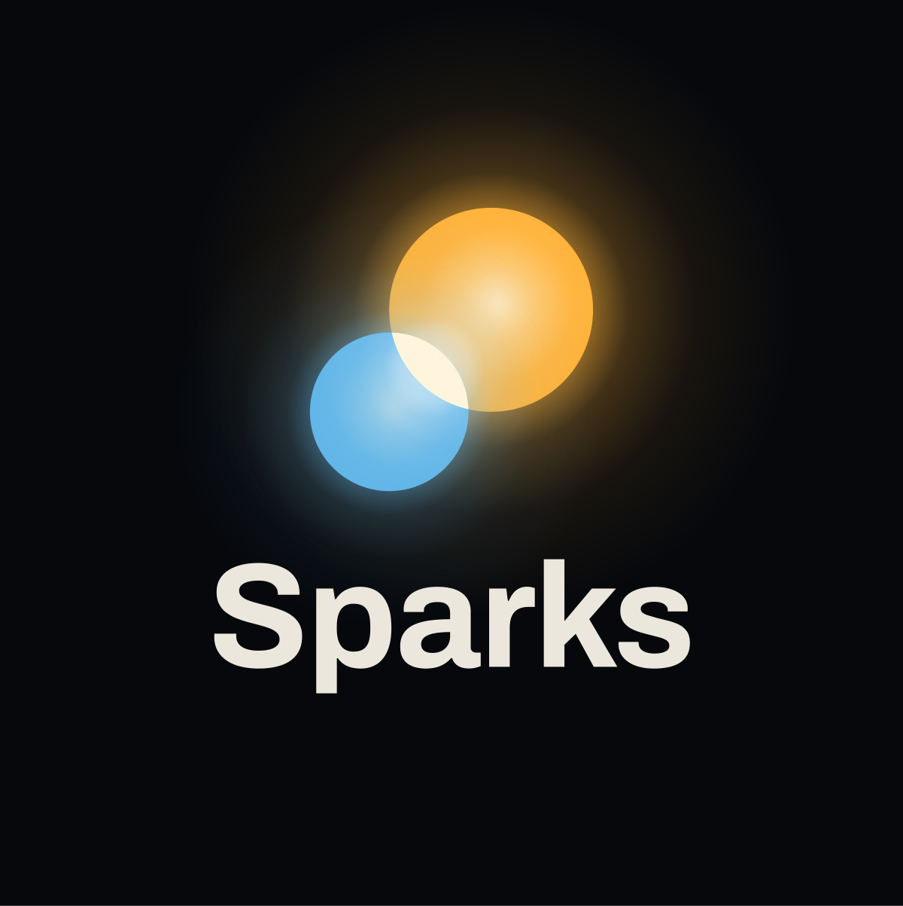

# Concepto 01 · Dos chispas

**Idea en una frase:** El mismo objeto en dos épocas: el punto azul de antes se encima tantito sobre el ámbar de ahora, y donde se tocan se enciende el parpadeo.

## Qué cuenta de Sparks
Es literalmente lo que ve el usuario en la vista de resta: la misma fuente en dos épocas, un lóbulo azul y uno ámbar pegados. El traslape es el instante del parpadeo de Tombaugh.

## Forma y silueta
Dos círculos en diagonal ↗. Azul r = 21 en (43.5, 76.5), ámbar r = 27 en (70.5, 49.5), sobre retícula de 120. Distancia entre centros 38.2; traslape 9.8 u (≈ 23 % del diámetro azul: "tantito"). Relación de tamaños 0.78: el ahora pesa más. Caja de tinta 75 × 75, cuadrada.

## Luz y glow
Halo radial propio por punto (ámbar 3.0 × r, azul 2.7 × r al 75 % de intensidad: el pasado brilla menos). Núcleo con centro cálido #FFF4DC muy suave, sin brillo especular (no es una esfera 3D). La intersección se pinta en blanco cálido con su propio destello: la luz de las dos épocas se suma.

## Sin glow
Plano: tres tintas (azul, ámbar, blanco cálido en la lente). Una tinta: dos discos con la lente calada, que funciona igual en sello, láser, bordado o serigrafía. La silueta "dos discos que se besan en diagonal" sobrevive sin color.

## Paleta
#06080C noche · #62B6E8 antes · #FFB238 ahora · #FFF4DC parpadeo · #ECE7DC placa (texto). Papel: #FAF8F3 · #2F8BCB · #F09A0C · lente #FFFFFF · tinta #0D1117.

## Estilo y composición
- **Estilo:** Geometría mínima, luz controlada. Ni neón ni 3D: discos planos con una caída de luz física.
- **Composición:** Apilado (símbolo arriba, nombre abajo, como pediste) como logo principal; horizontal para header y README; lockup con equipo.

## Tipografía y relación con el nombre
- Logotipo: **Archivo Bold (wght 700, wdth 100)** (SIL OFL 1.1), convertida a contornos en los SVG.
- Alternativa evaluada: **Space Grotesk SemiBold** (OFL), ver `type-study.png`.
- El símbolo mide 2.8 × la altura de mayúscula del nombre en el apilado; separación 0.26 × altura del símbolo. En horizontal, el símbolo es 1.75 × la altura de mayúscula.

## Animación de un segundo
0–0.25 s se enciende el azul (antes) · 0.35–0.45 s aparece el ámbar de golpe (ahora) · 0.55–0.7 s la lente destella en blanco cálido y se asienta. Ver `symbol-animated.svg` e `intro.png`.

## Fortalezas
Es la idea del equipo y se entiende en un segundo. Hereda los colores y el antes/ahora del logo original y elimina la lectura de pausa/toggle. Excelente a 16 px, en proyector y en una tinta. Es la versión más versátil.

## Limitaciones
Dos círculos encimados es un territorio visitado (Mastercard es el caso famoso: círculos iguales, horizontales, rojo/amarillo y traslape grande). Aquí la diagonal, los tamaños distintos, el traslape mínimo y la paleta lo separan, pero conviene que el equipo lo tenga presente frente al jurado. Sin contexto puede leerse como "dos esferas" y no como movimiento; la animación y el lema lo resuelven.

## Estudios
Estudios: [`overlap-study.png`](overlap-study.png) (4 grados de traslape × glow/plano/una tinta/16 px/papel, y quién va arriba), [`colorways.png`](colorways.png) (4 rutas cromáticas), [`type-study.png`](type-study.png) (Archivo vs. Space Grotesk).

**Decisiones del estudio**

- **Traslape:** 3 u se lee como dos objetos que se tocan; 16 u y 24 u ya parecen un solo objeto con mancha. 9.8 u mantiene dos chispas y una lente visible incluso a 32 px.
- **Quién va arriba:** con el azul encima (tu pedido) el ahora queda tapado por el pasado; con el ámbar encima se pierde la idea de que se enciman. Propongo que no vaya nadie arriba: la intersección se enciende y es el parpadeo. En los archivos `top="then"` y `top="now"` siguen disponibles con un solo parámetro en `concepts.py`.
- **Mezcla:** aditiva (blanco cálido) en noche; en papel la lente queda blanca y se lee como un destello o un hueco limpio. La mezcla sustractiva real (azul + ámbar = verde oliva) se descartó.
- **Dirección:** diagonal ↗, como el favicon actual de la app, que ya sube a la derecha.

## Puntuación (1–10)

| Criterio | Nota |
|---|---|
| Originalidad | 6 |
| Claridad de la idea | 9 |
| Relación con Sparks y el reto | 9 |
| Reconocimiento y memorabilidad | 8 |
| Calidad de ejecución | 8 |
| Funcionamiento a 16 px | 9 |
| Versatilidad | 9 |
| Facilidad de reproducción | 9 |
| Potencial de animación | 8 |
| Impacto frente al jurado | 8 |
| Diferenciación frente a logos espaciales | 7 |

## Archivos

| Archivo | Qué es |
|---|---|
| `symbol.svg` | Símbolo con glow (para fondo oscuro, sin fondo) |
| `symbol-flat.svg` / `symbol-flat-light.svg` | Plano sin filtros ni degradados, para fondo oscuro / claro |
| `symbol-mono-black.svg` / `symbol-mono-white.svg` | Una tinta |
| `symbol-animated.svg` | Animación SMIL de 1 s |
| `logo.svg` | Logo principal apilado, noche + glow |
| `logo-flat.svg` · `logo-light.svg` · `logo-mono-black.svg` · `logo-mono-white.svg` | Apilado: plano, papel, una tinta |
| `logo-horizontal.svg` · `logo-horizontal-light.svg` | Horizontal |
| `logo-team.svg` · `logo-team-light.svg` | Sparks · por Cosmonautas |
| `favicon.svg` · `favicon-16.png` · `favicon-32.png` · `favicon-180.png` | Favicon (tile noche) y apple-touch con glow |
| `preview-dark.png` · `preview-light.png` | Vista previa noche / papel |
| `system.png` | Tablero del sistema (todas las versiones, favicons a tamaño real) |
| `mockups.png` | Header + favicon, perfil, playera, stickers, thumbnail, README claro/oscuro |
| `pitch.png` · `intro.png` | Portada y cierre del pitch (con espacio para QR) · storyboard de la intro |

Todo se regenera con `assets/build/build.py` (la geometría está en `assets/build/concepts.py`).
