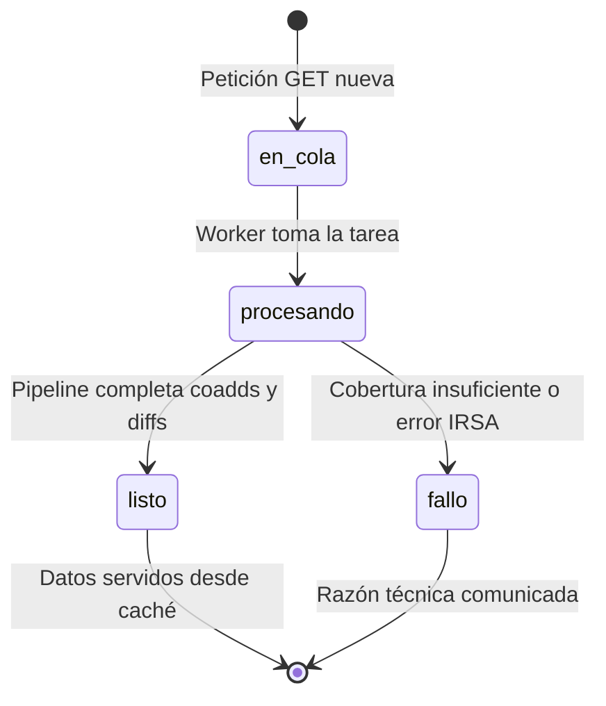

# Contrato de API y Arquitectura: Campos en Vivo

**Autor:** Cons  
**Fecha:** 14 de noviembre de 2026  
**Documento:** `docs/backend/api-campos-en-vivo.md`

---

## 1. El Reto y la Realidad Operativa
El desafío de NASA Space Apps SPHEREx establece que cualquier voluntario o astrónomo aficionado pueda ingresar coordenadas arbitrarias $(\alpha, \delta)$ del cielo para inspeccionar candidatos a movimiento o transitorios. Sin embargo, en el repositorio solo contamos con cinco campos precalculados.

### Tiempos y límites reales de la canalización de datos:
- Cada consulta a IRSA (SIA2 / TAP) requiere recuperar entre 200 y 500 cuadros por campo.
- Cada recorte pesa aproximadamente **4 a 5 MB** (cubo espectral PSF + datos).
- La descarga y reproyección de un campo nuevo toma entre **3 y 15 minutos** en serie (hasta 16 segundos por recorte en horas de alta carga).
- **Conclusión técnica:** Es imposible generar un campo nuevo en tiempo real dentro de la ventana síncrona HTTP típica (timeout de 30 segundos). La API debe ser **asíncrona**, desacoplada, con **cola de trabajo, caché persistente y rate limiting estricto**.

---

## 2. Especificación del Contrato REST

### Endpoint Principal
`GET /api/campo?ra={ra_deg}&dec={dec_deg}`

#### Parámetros de Consulta:
- `ra`: Ascensión recta en grados decimales $[0.0, 360.0]$.
- `dec`: Declinación en grados decimales $[-90.0, +90.0]$.

---

### Estados del Ciclo de Vida del Campo (`status`)



#### 1. Estado `en_cola` (HTTP 202 Accepted)
La petición fue recibida y encolada. El servidor responde inmediatamente con un identificador de seguimiento.
```json
{
  "status": "en_cola",
  "job_id": "job_ra269.448_dec4.767",
  "ra": 269.4486,
  "dec": 4.7672,
  "posicion_en_cola": 1,
  "estimado_segundos": 180,
  "mensaje": "Coordenadas encoladas para procesamiento de recortes SPHEREx."
}
```

#### 2. Estado `procesando` (HTTP 202 Accepted)
El pipeline backend está descargando cuadros de IRSA, enmascarando banderas o generando diferencias.
```json
{
  "status": "procesando",
  "job_id": "job_ra269.448_dec4.767",
  "progreso_porcentaje": 45,
  "etapa_actual": "Alineación de cuadros y sigma-clipping en temporada 2",
  "cuadros_descargados": 120,
  "cuadros_totales": 236,
  "estimado_segundos_restantes": 90
}
```

#### 3. Estado `listo` (HTTP 200 OK)
El campo fue procesado por completo o ya existía en la caché del servidor. Devuelve los metadatos completos idénticos a `manifest.json` y URLs relativas a los binarios y previsualizaciones.
```json
{
  "status": "listo",
  "field_id": "field_269448_047672",
  "cached": true,
  "manifest_url": "/data-cache/field_269448_047672/manifest.json",
  "data_base_url": "/data-cache/field_269448_047672/",
  "resumen": {
    "cobertura_temporadas": [0, 1, 2],
    "detectores": [1, 2, 3, 4, 5, 6],
    "veredicto_movimiento": "candidato_confirmado"
  }
}
```

#### 4. Estado `fallo` (HTTP 422 Unprocessable Entity o 504 Gateway Timeout)
No se pudo completar el campo debido a limitaciones físicas o del archivo.
```json
{
  "status": "fallo",
  "error_code": "COBERTURA_INSUFICIENTE",
  "mensaje": "SPHEREx QR2/QR3 solo cuenta con 1 temporada en esta región. Se requieren al menos 2 épocas para calcular diferencias.",
  "reintentable": false
}
```

---

## 3. Caché, Límites de Peticiones y Reintentos

1. **Caché Espacial:**  
   Dos consultas dentro de un radio de tolerancia de $30''$ ($\approx 5$ píxeles de SPHEREx) reutilizan el mismo mosaico de $64 \times 64$ píxeles centrado en la primera consulta, evitando redescargas redundantes.
2. **Rate Limiting hacia IRSA:**  
   - Máximo 2 descargas de recortes simultáneas para respetar la política de uso justo del Caltech/IPAC IRSA.
   - Cola FIFO con prioridad para campos ya iniciados.
3. **Manejo de Reintentos:**  
   - Timeout de conexión: 20 segundos con hasta 3 reintentos con espera exponencial ($2^n$ segundos).
   - En caso de falla permanente, se guarda el estado en caché para no saturar al proveedor externo con reintentos inútiles.

---

## 4. Qué puede garantizar el servidor y qué no
- **Lo que SÍ se garantiza:** Integridad del contrato JSON, persistencia de resultados procesados y reporte honesto del estado paso a paso.
- **Lo que NO se puede garantizar:** Disponibilidad inmediata (latencia de red inherente a archivos de giga-escala de NASA) ni cobertura homogénea en todo el cielo en lanzamientos tempranos (QR2/QR3).
